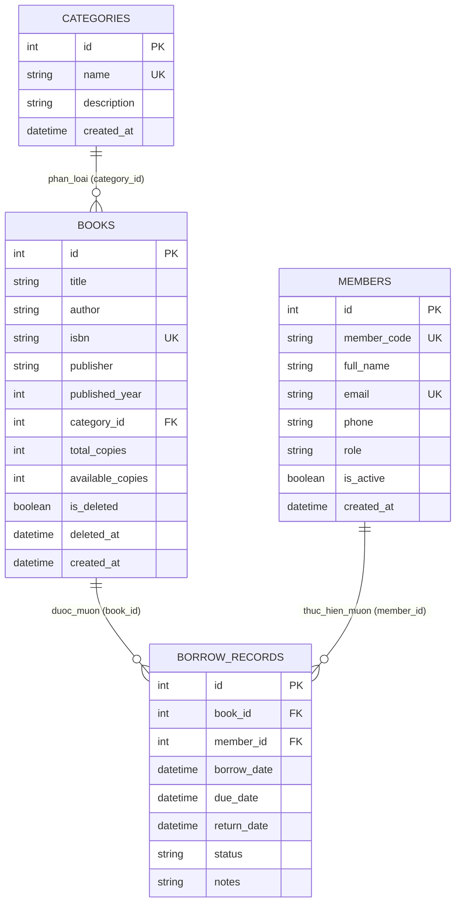

# BÁO CÁO PHÂN TÍCH, THIẾT KẾ VÀ TRIỂN KHAI HỆ THỐNG QUẢN LÝ THƯ VIỆN (AIquanlythuvien)

---

## 1. Giới thiệu

### 1.1. Mục tiêu hệ thống
**AIquanlythuvien** là hệ thống phần mềm quản lý thư viện hỗ trợ thủ thư quản lý danh mục đầu sách, phân loại theo thể loại, tra cứu – lọc sách theo thời gian thực, theo dõi nghiệp vụ mượn/trả sách của độc giả và tích hợp trợ lý AI gợi ý sách theo chủ đề học thuật.

Trong phạm vi bài Lab này, hệ thống tập trung giải quyết trọn vẹn User Story trọng tâm phía quản trị:
> *"Là thủ thư, tôi muốn dễ dàng xem và tìm kiếm để quản lý sách"* — triển khai trang quản lý sách phía quản trị với **tìm kiếm theo tên sách + lọc theo thể loại (danh mục)** đáp ứng đầy đủ các tiêu chí nghiệm thu **AC1–AC14** và tiêu chí trải nghiệm người dùng **UX1–UX7**.

### 1.2. Công nghệ sử dụng (nhận diện thực tế từ mã nguồn)

| Thành phần | Công nghệ / Thư viện | Phiên bản / Ghi chú |
|---|---|---|
| **Backend Language & Framework** | Python + FastAPI | Python 3.13, FastAPI 0.115+, Uvicorn 0.30+ |
| **ORM & Cơ sở dữ liệu** | SQLAlchemy 2.0 + SQLite | `sqlite:///./library.db` (tích hợp hàm Unicode `u_lower`) |
| **Data Validation / DTO** | Pydantic v2 | `pydantic>=2.9.0`, `ConfigDict(from_attributes=True)` |
| **Backend Automated Testing** | Pytest + FastAPI TestClient (HTTPX) | `pytest>=8.0.0`, SQLite in-memory isolated fixture |
| **Frontend Stack** | Modular ES6+ SPA (Vanilla JS + CSS3) | Tách biệt `api/`, `types/`, `components/`, `views/`, `utils/` |
| **Frontend Build / Lint / Test** | Node.js 22 Built-in Tooling | `npm run build`, `npm run lint`, `node --test` (`node:test`) |
| **AI Integration** | Google Gemini API / Local Catalog Fallback | Biến môi trường `GEMINI_API_KEY`, `GEMINI_MODEL=gemini-1.5-flash` |

---

## 2. Danh sách chức năng

Bảng dưới đây liệt kê toàn bộ các chức năng dựa trên route/endpoint và giao diện thực tế trong repository:

| STT | Chức năng | Vai trò sử dụng | Mô tả | Trạng thái |
|---|---|---|---|---|
| 1 | Xem danh sách sách có phân trang | Thủ thư (Admin) | Hiển thị danh sách sách chưa xoá (`is_deleted=False`), kèm tên thể loại, tồn kho (`available_copies/total_copies`) và phân trang (`GET /api/books`). | **Đã có** |
| 2 | Tìm kiếm sách theo tên sách | Thủ thư (Admin) | Tìm kiếm khớp chuỗi con (substring), không phân biệt hoa/thường (hỗ trợ tiếng Việt Unicode), tự động `trim()` khoảng trắng và escape ký tự `%`, `_` (`GET /api/books?keyword=...`). | **Đã có** |
| 3 | Lọc sách theo thể loại & kết hợp tìm kiếm (AND) | Thủ thư (Admin) | Lọc sách theo `category_id` hoặc kết hợp đồng thời `keyword` VÀ `category_id`, tính lại `total` và `total_pages` sau khi lọc (`GET /api/books?keyword=...&category_id=...`). | **Đã có** |
| 4 | Tìm kiếm thể loại từ Backend trong Dropdown | Thủ thư (Admin) | Dropdown thể loại cho phép gõ từ khoá để tìm trực tiếp từ backend với `limit` hợp lý, giữ nguyên thể loại đang chọn khi tìm (`GET /api/categories?keyword=...&limit=15`). | **Đã có** |
| 5 | Xoá mềm sách (Soft Delete) | Thủ thư (Admin) | Đánh dấu `is_deleted=True` và ghi nhận `deleted_at`, loại bỏ sách đã xoá khỏi mọi truy vấn danh sách, tìm kiếm, lọc và tổng số bản ghi (`DELETE /api/books/{book_id}`). | **Đã có** |
| 6 | Quản lý danh sách phiếu mượn | Thủ thư (Admin) | Xem danh sách toàn bộ phiếu mượn kèm thông tin sách, độc giả, ngày mượn, hạn trả, ngày trả thực tế và trạng thái (`GET /api/borrowings`). | **Đã có** |
| 7 | Tạo phiếu mượn sách | Thủ thư (Admin) | Kiểm tra sách còn bản khả dụng (`available_copies > 0`), kiểm tra độc giả đang hoạt động (`is_active=True`), tạo phiếu mượn và trừ tồn kho (`POST /api/borrowings`). | **Đã có** |
| 8 | Xác nhận trả sách & kiểm tra quá hạn | Thủ thư (Admin) | Ghi nhận `return_date`, đối chiếu với `due_date` để cập nhật trạng thái `returned` hoặc `overdue`, đồng thời hoàn lại số bản khả dụng (`POST /api/borrowings/{record_id}/return`). | **Đã có** |
| 9 | Trợ lý AI gợi ý sách theo chủ đề | Thủ thư / Độc giả | Gợi ý các đầu sách phù hợp trong kho theo chủ đề quan tâm qua cấu hình Gemini hoặc chế độ đối sánh danh mục cục bộ (`POST /api/ai/recommend`). | **Đã có** |
| 10 | Thêm mới / Cập nhật thông tin sách qua Form UI | Thủ thư (Admin) | Giao diện form thêm mới hoặc chỉnh sửa thông tin chi tiết đầu sách. | **Chưa có** |
| 11 | Đăng nhập / Phân quyền xác thực JWT | Thủ thư / Độc giả | Xác thực phiên đăng nhập bằng mật khẩu và JWT token. | **Chưa có** |
| 12 | Cổng tra cứu công khai & Đặt trước sách (Reservation) | Độc giả | Trang catalog riêng cho độc giả tự đặt lịch giữ sách trực tuyến. | **Chưa có** |
| 13 | Tính và thu phí phạt quá hạn tự động | Thủ thư (Admin) | Quản lý biên lai thu tiền phạt theo số ngày trả trễ. | **Chưa có** |

---

## 3. Sơ đồ quy trình Mượn/Trả

Quy trình Mượn/Trả sách dưới đây được mô tả trực tiếp từ logic thực tế trong mã nguồn:
- **File router:** `src/backend/app/routers/borrowings.py` (các hàm `get_borrowings`, `create_borrowing`, `return_borrowing`)
- **File service:** `src/backend/app/services/borrowing_service.py` (các hàm `list_borrow_records`, `borrow_book`, `return_book`)

```mermaid
flowchart TD
    subgraph LUONG_MUON["Luồng Mượn Sách (POST /api/borrowings -> borrow_book)"]
        M1["Nhận yêu cầu mượn: book_id, member_id, loan_days"] --> M2{"Tìm Book theo book_id\nvà is_deleted == False?"}
        M2 -- "Không tồn tại" --> M_ERR1["Trả lỗi HTTP 404:\nKhông tìm thấy sách hoặc ngừng phục vụ"]
        M2 -- "Tồn tại" --> M3{"Kiểm tra tồn kho:\navailable_copies > 0?"}
        M3 -- "Hết sách (<= 0)" --> M_ERR2["Trả lỗi HTTP 400:\nSách hiện đã hết bản có sẵn"]
        M3 -- "Còn sách" --> M4{"Tìm Member theo member_id\nvà is_active == True?"}
        M4 -- "Không tồn tại / Bị khoá" --> M_ERR3["Trả lỗi HTTP 404 / 400:\nĐộc giả không hợp lệ"]
        M4 -- "Hợp lệ" --> M5["Tạo BorrowRecord:\nstatus = 'borrowed'\ndue_date = borrow_date + loan_days"]
        M5 --> M6["Cập nhật tồn kho:\nbook.available_copies -= 1\ndb.commit()"]
        M6 --> M7["Trả về HTTP 200:\nBorrowRecordResponse"]
    end

    subgraph LUONG_TRA["Luồng Trả Sách (POST /api/borrowings/{record_id}/return -> return_book)"]
        T1["Nhận yêu cầu trả sách: record_id"] --> T2{"Tìm BorrowRecord\ntheo record_id?"}
        T2 -- "Không tồn tại" --> T_ERR1["Trả lỗi HTTP 404:\nKhông tìm thấy phiếu mượn"]
        T2 -- "Tồn tại" --> T3{"Phiếu đã trả trước đó?\n(return_date != None hoặc status == 'returned')"}
        T3 -- "Đã trả" --> T_ERR2["Trả lỗi HTTP 400:\nPhiếu mượn đã được trả trước đó"]
        T3 -- "Chưa trả" --> T4["Gán return_date = utc_now()"]
        T4 --> T5{"Kiểm tra quá hạn:\nreturn_date > due_date?"}
        T5 -- "Quá hạn" --> T6["status = 'overdue'\nGhi chú: 'Trả sách quá hạn'"]
        T5 -- "Đúng hạn" --> T7["status = 'returned'"]
        T6 --> T8["Hoàn tồn kho (nếu available < total):\nbook.available_copies += 1\ndb.commit()"]
        T7 --> T8
        T8 --> T9["Trả về HTTP 200:\nBorrowRecordResponse"]
    end
```

---

## 4. Bảng mô tả cấu trúc dữ liệu

Cấu trúc cơ sở dữ liệu được trích xuất trực tiếp từ `src/backend/app/models.py`.

### 4.1. Sơ đồ quan hệ thực thể (ER Diagram)

### 4.2. Chi tiết các bảng dữ liệu

#### Bảng 1: `categories` (Thể loại sách)
| Tên trường | Kiểu dữ liệu | Khoá (PK/FK/UNIQUE) | Ràng buộc | Mô tả |
|---|---|---|---|---|
| `id` | `Integer` | `PK` | `AUTOINCREMENT`, `NOT NULL` | Định danh duy nhất của thể loại |
| `name` | `String(100)` | `UNIQUE` | `NOT NULL`, `INDEX` | Tên thể loại sách (ví dụ: `Công nghệ thông tin`) |
| `description` | `String(255)` | — | `NULLABLE` | Mô tả chi tiết về nhóm thể loại |
| `created_at` | `DateTime` | — | `NOT NULL`, Default `utc_now` | Thời điểm tạo bản ghi |

#### Bảng 2: `books` (Đầu sách)
| Tên trường | Kiểu dữ liệu | Khoá (PK/FK/UNIQUE) | Ràng buộc | Mô tả |
|---|---|---|---|---|
| `id` | `Integer` | `PK` | `AUTOINCREMENT`, `NOT NULL` | Định danh duy nhất của sách |
| `title` | `String(255)` | — | `NOT NULL`, `INDEX` | Tên sách (trường dùng để tìm kiếm theo keyword) |
| `author` | `String(150)` | — | `NOT NULL` | Tên tác giả |
| `isbn` | `String(20)` | `UNIQUE` | `NOT NULL` | Mã số sách tiêu chuẩn quốc tế ISBN |
| `publisher` | `String(150)` | — | `NULLABLE` | Nhà xuất bản |
| `published_year` | `Integer` | — | `NULLABLE` | Năm xuất bản |
| `category_id` | `Integer` | `FK -> categories.id` | `NOT NULL`, `INDEX` | Khoá ngoại liên kết tới bảng `categories` |
| `total_copies` | `Integer` | — | `NOT NULL`, Default `1` | Tổng số bản sách có trong thư viện |
| `available_copies` | `Integer` | — | `NOT NULL`, Default `1` | Số bản sách hiện có sẵn để cho mượn |
| `is_deleted` | `Boolean` | — | `NOT NULL`, Default `False`, `INDEX` | Cờ đánh dấu xoá mềm (`True` = đã xoá) |
| `deleted_at` | `DateTime` | — | `NULLABLE` | Thời điểm thực hiện xoá mềm |
| `created_at` | `DateTime` | — | `NOT NULL`, Default `utc_now` | Thời điểm tạo đầu sách |

#### Bảng 3: `members` (Độc giả & Thủ thư)
| Tên trường | Kiểu dữ liệu | Khoá (PK/FK/UNIQUE) | Ràng buộc | Mô tả |
|---|---|---|---|---|
| `id` | `Integer` | `PK` | `AUTOINCREMENT`, `NOT NULL` | Định danh người dùng/độc giả |
| `member_code` | `String(30)` | `UNIQUE` | `NOT NULL`, `INDEX` | Mã thẻ thư viện (ví dụ: `LIB001`, `MEM001`) |
| `full_name` | `String(150)` | — | `NOT NULL` | Họ và tên |
| `email` | `String(150)` | `UNIQUE` | `NOT NULL` | Địa chỉ email liên hệ |
| `phone` | `String(20)` | — | `NULLABLE` | Số điện thoại |
| `role` | `String(20)` | — | `NOT NULL`, Default `'member'` | Vai trò: `'librarian'` (thủ thư) hoặc `'member'` (độc giả) |
| `is_active` | `Boolean` | — | `NOT NULL`, Default `True` | Trạng thái hoạt động của thẻ |
| `created_at` | `DateTime` | — | `NOT NULL`, Default `utc_now` | Thời điểm đăng ký |

#### Bảng 4: `borrow_records` (Phiếu mượn / trả sách)
| Tên trường | Kiểu dữ liệu | Khoá (PK/FK/UNIQUE) | Ràng buộc | Mô tả |
|---|---|---|---|---|
| `id` | `Integer` | `PK` | `AUTOINCREMENT`, `NOT NULL` | Mã phiếu mượn |
| `book_id` | `Integer` | `FK -> books.id` | `NOT NULL`, `INDEX` | Đầu sách được mượn |
| `member_id` | `Integer` | `FK -> members.id` | `NOT NULL`, `INDEX` | Độc giả mượn sách |
| `borrow_date` | `DateTime` | — | `NOT NULL`, Default `utc_now` | Thời điểm mượn sách |
| `due_date` | `DateTime` | — | `NOT NULL` | Hạn phải trả sách |
| `return_date` | `DateTime` | — | `NULLABLE` | Thời điểm trả sách thực tế (`NULL` nếu chưa trả) |
| `status` | `String(20)` | — | `NOT NULL`, Default `'borrowed'`, `INDEX` | Trạng thái: `'borrowed'`, `'returned'`, `'overdue'` |
| `notes` | `String(255)` | — | `NULLABLE` | Ghi chú phiếu mượn / ghi chú quá hạn |

---

## 5. Tính năng tìm kiếm & lọc sách (Phần A)

### 5.1. Mô tả tham số API

#### Endpoint 1: `GET /api/books` (Danh sách sách có tìm kiếm, lọc thể loại và phân trang)
| Tham số | Kiểu | Bắt buộc / Tuỳ chọn | Mặc định | Ràng buộc / Mô tả |
|---|---|---|---|---|
| `keyword` | `string` | Tuỳ chọn | `None` | Từ khoá tìm kiếm theo **tên sách** (`Book.title`). |
| `category_id` | `integer` | Tuỳ chọn | `None` | ID thể loại dùng để lọc sách (`Book.category_id`). Sai kiểu trả về HTTP 422. |
| `page` | `integer` | Tuỳ chọn | `1` | Số thứ tự trang hiện tại (`ge=1`). |
| `page_size` | `integer` | Tuỳ chọn | `5` | Số lượng sách mỗi trang (`ge=1, le=100`). |

#### Endpoint 2: `GET /api/categories` (Tìm kiếm danh sách thể loại cho Dropdown)
| Tham số | Kiểu | Bắt buộc / Tuỳ chọn | Mặc định | Ràng buộc / Mô tả |
|---|---|---|---|---|
| `keyword` | `string` | Tuỳ chọn | `None` | Từ khoá tìm kiếm theo **tên thể loại** (`Category.name`). |
| `limit` | `integer` | Tuỳ chọn | `20` | Giới hạn số lượng thể loại trả về (`ge=1, le=100`, Frontend gọi với `limit=15`). |

### 5.2. Quy tắc chuẩn hoá Keyword & Các trường hợp đặc biệt (`src/backend/app/utils/search.py`)
1. **Cắt khoảng trắng (`trim`)**: Mọi chuỗi `keyword` đều được `.strip()` ở đầu và cuối. Nếu chuỗi sau khi `strip()` là rỗng (`""`) hoặc ban đầu chỉ chứa khoảng trắng (`"   "`, `"\t\n"`), hàm `normalize_keyword()` trả về `None` để bỏ qua điều kiện lọc.
2. **Khớp chuỗi con không phân biệt hoa/thường (Unicode Case-insensitive Substring)**:
   - Đăng ký hàm SQLite UDF `u_lower` qua SQLAlchemy connection listener (`src/backend/app/database.py`), đảm bảo chuyển chữ thường chính xác cho cả ký tự tiếng Việt có dấu (ví dụ `"LẬP TRÌNH PYTHON"` khớp `"Lập trình Python cơ bản"`).
3. **Escape ký tự đại diện (`%`, `_`, `\`)**:
   - Hàm `escape_like_literal()` chuyển `\` thành `\\`, `%` thành `\%`, và `_` thành `\_`, kết hợp với mệnh đề `LIKE ... ESCAPE '\'`.
   - Nhờ đó các từ khoá chứa `%`, `_`, `100%` được tìm kiếm theo đúng nghĩa ký tự literal, tuyệt đối không bị hiểu nhầm là wildcard lấy toàn bộ bảng.
4. **Kết hợp điều kiện và loại trừ sách đã xoá**:
   - Mọi truy vấn trên bảng `Book` luôn có điều kiện nền `Book.is_deleted.is_(False)`.
   - Khi truyền đồng thời `keyword` và `category_id`, hai điều kiện được nối bằng phép **AND** trước khi tính `total = query.count()` và `total_pages = ceil(total / page_size)`.

---

## 6. Quá trình sử dụng Google AI Studio / Antigravity IDE

### 6.1. Quy trình làm việc với AI
1. **Khảo sát & Thiết kế cấu trúc (Phase 0 – Phase 1)**: Sử dụng Antigravity IDE để kiểm tra môi trường runtime (Python 3.13, Node.js 22, Git), thiết kế mô hình dữ liệu 4 bảng (`categories`, `books`, `members`, `borrow_records`) và định nghĩa hợp đồng API đáp ứng AC1–AC14.
2. **Triển khai Backend & Kiểm thử tự động (Phase 2 – Phase 3)**: Yêu cầu AI sinh tầng dịch vụ tìm kiếm chuẩn hoá `normalize_keyword` + `escape_like_literal`, sau đó viết bộ 17 automated integration tests bằng `pytest` kiểm chứng từng tiêu chí AC1–AC7.
3. **Triển khai Frontend & Tối ưu UX (Phase 4 – Phase 5)**: Xây dựng giao diện Quản lý Sách với debounce 300ms, xử lý race condition bằng `AbortController` + token, hỗ trợ phím `Enter` tìm ngay, điều hướng bàn phím trong dropdown thể loại và kiểm tra responsive ở kích thước `375px`.
4. **Kiểm chứng chéo (Verification)**: Mọi đoạn mã do AI đề xuất đều được chạy kiểm chứng thực tế qua `pytest`, `npm run lint`, `npm run build`, `npm test` và thao tác trực tiếp trên trình duyệt.

### 6.2. Các vị trí chèn ảnh chụp màn hình quá trình làm việc với AI (do người dùng tự chụp)

> 📷 **[CẦN CHÈN ẢNH — người dùng tự chụp]** `docs/screenshots/ai_01_prompt.png` — Màn hình prompt yêu cầu ban đầu gửi cho Antigravity IDE.

> 📷 **[CẦN CHÈN ẢNH — người dùng tự chụp]** `docs/screenshots/ai_02_plan.png` — Màn hình danh sách các bước thực hiện (Steps / Task Checklist) của Antigravity IDE.

> 📷 **[CẦN CHÈN ẢNH — người dùng tự chụp]** `docs/screenshots/ai_03_test_results.png` — Màn hình terminal trong Antigravity IDE hiển thị kết quả chạy 17/17 test backend (`pytest`) và 3/3 test frontend (`npm test`).

> 📷 **[CẦN CHÈN ẢNH — người dùng tự chụp]** `docs/screenshots/ai_04_git_diff.png` — Màn hình kiểm tra thay đổi mã nguồn (`git status` / `git diff`) trên Antigravity IDE trước khi commit.

> 📷 **[CẦN CHÈN ẢNH — người dùng tự chụp]** `docs/screenshots/ai_05_ai_studio.png` — Màn hình thử nghiệm prompt hoặc cấu hình API trên Google AI Studio (nếu có sử dụng).

---

## 7. Ảnh chụp ứng dụng khi chạy

> **Ghi chú trung thực từ môi trường thực thi:** Backend (`http://127.0.0.1:8000`) và Frontend (`http://127.0.0.1:5173`) đã khởi chạy thành công, tuy nhiên công cụ trình duyệt tự động bị chặn do Chrome trên máy chưa bật `DevToolsActivePort` (`C:\Users\DELL\AppData\Local\Google\Chrome\User Data\DevToolsActivePort` ENOENT). Do đó các ảnh chụp giao diện ứng dụng dưới đây được đặt ở dạng **placeholder (chưa chụp tự động)** để người dùng chụp trực tiếp khi mở `http://127.0.0.1:5173`:

> 📷 **[CẦN CHÈN ẢNH — chưa chụp tự động do thiếu Chrome DevToolsActivePort]** `docs/screenshots/app_01_books_list.png` — Màn hình danh sách sách mặc định (`Tìm thấy 16 sách`, phân trang 5 sách/trang, dropdown `Tất cả thể loại`, nút `Xoá bộ lọc` ở trạng thái disabled).

> 📷 **[CẦN CHÈN ẢNH — chưa chụp tự động do thiếu Chrome DevToolsActivePort]** `docs/screenshots/app_02_search_keyword.png` — Màn hình tìm kiếm sách với từ khoá `Python` (`Tìm thấy 3 sách`: *"Lập trình Python cơ bản"*, *"Lập trình Python nâng cao cho Web"*, *"Phân tích dữ liệu với Python và Pandas"*).

> 📷 **[CẦN CHÈN ẢNH — chưa chụp tự động do thiếu Chrome DevToolsActivePort]** `docs/screenshots/app_03_filter_category.png` — Màn hình gõ tìm và chọn thể loại `Công nghệ thông tin` trong searchable dropdown (hiển thị 7 sách thuộc thể loại `Công nghệ thông tin` hoặc 2 sách khi kết hợp với từ khoá `Python`).

> 📷 **[CẦN CHÈN ẢNH — chưa chụp tự động do thiếu Chrome DevToolsActivePort]** `docs/screenshots/app_04_empty_state.png` — Màn hình trạng thái rỗng hiển thị đúng thông báo `Không tìm thấy sách phù hợp` kèm gợi ý hành động khi nhập từ khoá không khớp.

> 📷 **[CẦN CHÈN ẢNH — chưa chụp tự động do thiếu Chrome DevToolsActivePort]** `docs/screenshots/app_05_borrowings.png` — Màn hình tab `Mượn / Trả` hiển thị danh sách phiếu mượn mẫu của độc giả `Nguyễn Minh Tuấn (MEM001)`.

---

## 8. Kết quả kiểm thử

### 8.1. Tổng hợp số lượng test
- **Backend Automated Tests (`pytest`):** `17 passed in 0.97s` (0 failed, 0 skipped).
- **Frontend Automated Logic Tests (`npm test`):** `3 passed` (0 failed).
- **Frontend Lint & Build (`npm run lint && npm run build`):** Thành công 100% (9 modules checked).

### 8.2. Bảng ánh xạ AC → Kiểm thử

| Mã AC | Nội dung yêu cầu | Hàm test / Phương thức kiểm chứng | Kết quả |
|---|---|---|---|
| **AC1** | Tìm theo tên sách (substring, không phân biệt hoa/thường, trim, rỗng/whitespace) | `test_ac1_search_by_title_normalized_matches_seed_book` (5 biến thể), `test_ac1_empty_or_whitespace_keyword_does_not_filter` (3 biến thể) | **PASS** |
| **AC2** | Lọc theo `category_id` chỉ trả về sách thuộc thể loại đó | `test_ac2_filter_by_category_id` | **PASS** |
| **AC3** | Kết hợp `keyword` + `category_id` theo logic AND | `test_ac3_combine_keyword_and_category_uses_and_logic` | **PASS** |
| **AC4** | `total` và `total_pages` tính sau khi áp dụng mọi filter; phân trang chính xác | `test_ac4_total_and_pagination_calculated_after_filters` | **PASS** |
| **AC5** | Keyword không khớp hoặc `category_id` không tồn tại trả về HTTP 200 + danh sách rỗng | `test_ac5_non_matching_keyword_or_non_existent_category_returns_200_empty` | **PASS** |
| **AC6** | Ký tự `%`, `_`, `100%` được escape và tìm đúng nghĩa literal | `test_ac6_special_like_wildcards_are_escaped_as_literals` | **PASS** |
| **AC7** | Sách đã xoá mềm (`is_deleted=True`) bị loại khỏi mọi truy vấn và `total` | `test_ac7_deleted_books_excluded_everywhere` | **PASS** |
| **AC8** | Ô tìm kiếm tên sách + dropdown thể loại mặc định `Tất cả thể loại` | Kiểm chứng trên `BooksAdminView.js` & trình duyệt thực tế | **PASS** |
| **AC9** | Đổi filter về trang 1; chuyển trang giữ nguyên filter | Kiểm chứng trên `BooksAdminView.js`, `filterLogic.test.js` & trình duyệt | **PASS** |
| **AC10** | Dropdown thể loại tìm kiếm từ backend có `limit`, giữ lựa chọn hiện tại, báo `Không tìm thấy thể loại` | `test_categories_search_normalization_and_limit` + `SearchableCategoryDropdown.js` | **PASS** |
| **AC11** | Cột thể loại hiển thị tên thể loại (`category_name`) thay vì ID | `BookResponse.category_name` + hiển thị trong bảng `BooksAdminView.js` | **PASS** |
| **AC12** | Debounce ~300ms cho keyword sách và thể loại + chống race condition | `createDebounce`, `createRaceGuard` (`AbortController` + token) trong `filterLogic.test.js` | **PASS** |
| **AC13** | Rỗng do filter hiển thị `Không tìm thấy sách phù hợp`; không hiện khi đang loading | Kiểm chứng trên `BooksAdminView.js` & trình duyệt thực tế | **PASS** |
| **AC14** | Nút `Xoá bộ lọc` đưa keyword về rỗng, thể loại về `Tất cả thể loại`, về trang 1 | Kiểm chứng trên `BooksAdminView.js` & trình duyệt thực tế | **PASS** |

---

## 9. Hạn chế & Hướng phát triển

1. **Hiệu năng tìm kiếm chuỗi con (`LIKE '%keyword%'`) khi dữ liệu lớn:**
   - Truy vấn `LIKE '%...%'` dẫn đầu bằng ký tự đại diện không tận dụng được B-Tree index chuẩn, có thể cần quét toàn bảng khi số lượng đầu sách lên tới hàng trăm nghìn bản ghi.
   - *Hướng phát triển:* Tích hợp SQLite FTS5 (Full-Text Search) hoặc PostgreSQL `pg_trgm` (GIN/GiST trigram index) cho tìm kiếm substring tốc độ cao.
2. **Xác thực và phân quyền người dùng:**
   - Hiện tại giao diện quản trị hoạt động trực tiếp với tài khoản thủ thư mặc định trong phiên làm việc.
   - *Hướng phát triển:* Bổ sung hệ thống đăng nhập OAuth2/JWT và phân quyền RBAC giữa Thủ thư (`librarian`) và Độc giả (`member`).
3. **Quản lý thêm/sửa đầu sách và đặt trước trực tuyến:**
   - *Hướng phát triển:* Bổ sung giao diện CRUD hoàn chỉnh (Thêm/Sửa sách, Quản lý nhà xuất bản) và cổng tra cứu dành riêng cho độc giả đặt giữ sách.
