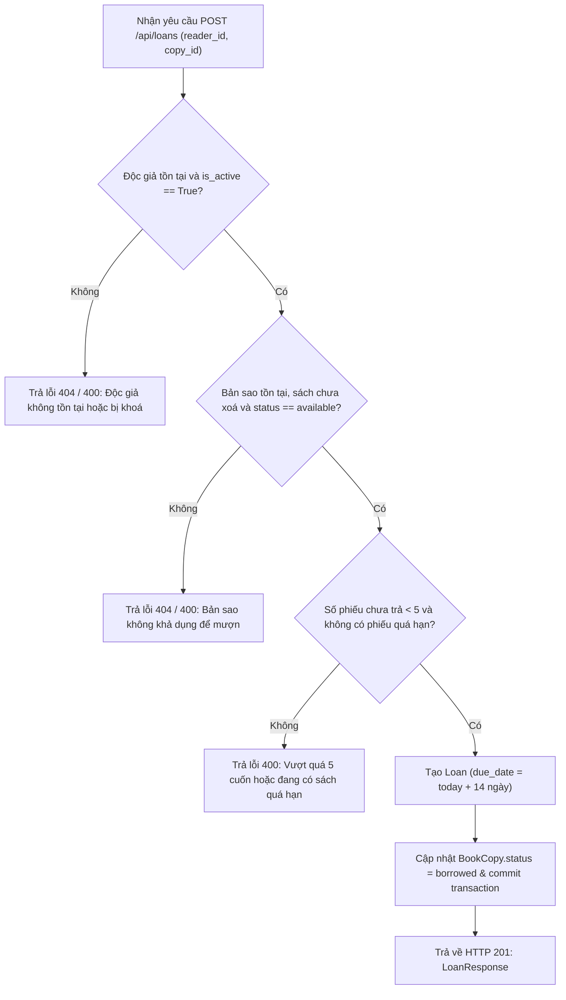
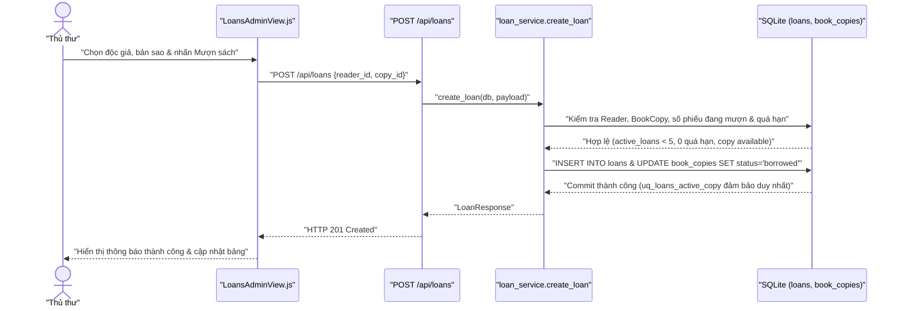
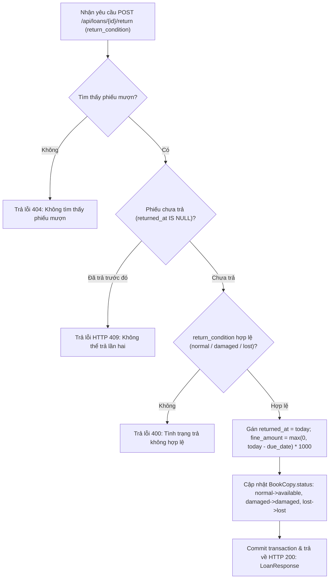
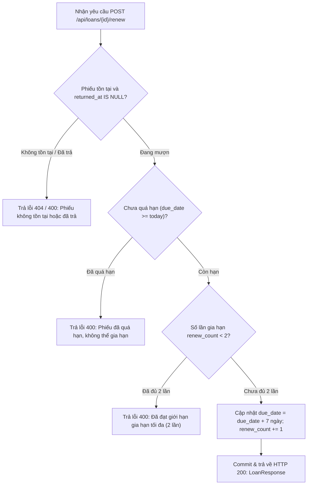
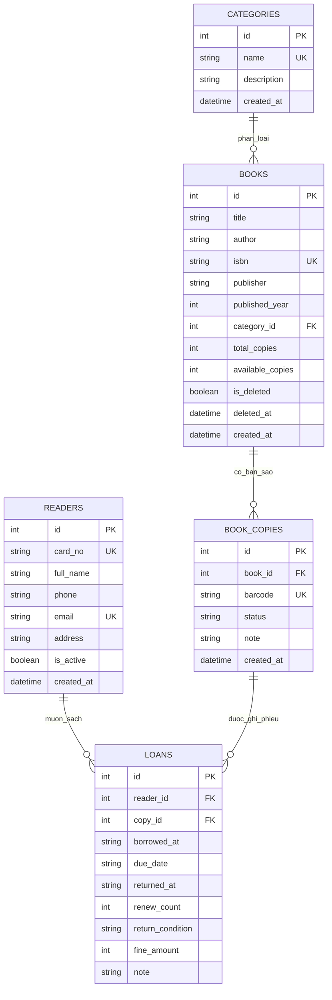
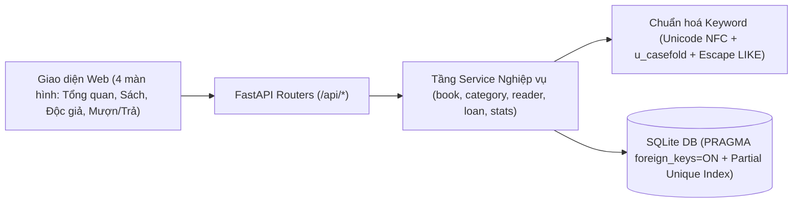

# BÁO CÁO BÀI THỰC HÀNH LAB 02
## Đề tài: Phân tích, thiết kế và xây dựng hệ thống Quản lý Thư viện ứng dụng công cụ AI

- **Họ và tên sinh viên:** `HoTen` *(Người dùng điền họ tên thật trước khi nộp)*
- **Mã số sinh viên (MSSV):** `MSSV` *(Người dùng điền MSSV thật trước khi nộp)*
- **Mã học phần / Bài thực hành:** LAB 02 — Quản lý Thư viện Số (`AIquanlythuvien`)
- **Ngày hoàn thành:** 23/11/2026
- **GitHub Repository:** https://github.com/anh-pc/AIquanlythuvien.git (nhánh `main`)

---

## PHẦN I — PHÂN TÍCH HỆ THỐNG

### 1. Bối cảnh & Mục tiêu
Trong quy trình vận hành thư viện truyền thống bằng sổ sách hoặc bảng tính rời rạc, thủ thư thường gặp khó khăn khi cần kiểm soát chính xác từng cuốn sách vật lý (bản sao nào còn trên kệ, bản sao nào đang được độc giả mượn, bản sao nào bị rách/hư hỏng hay thất lạc). Ngoài ra, việc kiểm tra điều kiện mượn (độc giả có đang giữ sách quá hạn hay đã vượt số lượng sách tối đa chưa), tính số ngày trễ hạn và tra cứu lịch sử mượn tốn nhiều thời gian và dễ phát sinh sai sót.

Hệ thống **AIquanlythuvien** được xây dựng nhằm số hoá toàn diện hoạt động quản trị thư viện:
- Quản lý tách biệt giữa **Đầu sách (`books`)** và từng **Bản sao vật lý (`book_copies`)** theo mã vạch (`barcode`) và 4 trạng thái chuẩn.
- Tự động hoá kiểm tra ràng buộc nghiệp vụ khi **Mượn – Trả – Gia hạn** sách trong giao dịch an toàn (ACID transaction).
- Hỗ trợ tra cứu tức thời theo **tên sách hoặc tác giả** (xử lý chuẩn tiếng Việt có dấu Unicode NFC) kết hợp lọc theo thể loại và xem thống kê thời gian thực.

---

### 2. Danh sách chức năng

Bảng dưới đây đối chiếu toàn bộ các chức năng trong hệ thống thực tế:

| Mã | Chức năng | Người dùng | Mô tả | Ưu tiên | Trạng thái |
|---|---|---|---|---|---|
| **F1** | Quản lý đầu sách: xem, thêm, sửa, xoá mềm | Thủ thư | Xem danh sách đầu sách, thêm mới kèm số bản sao ban đầu, cập nhật thông tin và xoá mềm (`is_deleted=True`, chặn xoá khi có bản sao đang mượn). | M | **Đã làm** |
| **F2** | Quản lý bản sao của đầu sách và tình trạng | Thủ thư | Xem các bản sao theo đầu sách, thêm bản sao mới, chuyển trạng thái giữa *Còn trong kho*, *Hư hỏng*, *Thất lạc* (chặn đổi tay sang/ra *Đang mượn*). | M | **Đã làm** |
| **F3** | Quản lý độc giả: xem, thêm, sửa, vô hiệu hoá | Thủ thư | Quản lý hồ sơ thẻ độc giả (`card_no`), cập nhật liên hệ và khoá/mở thẻ (chặn vô hiệu hoá khi độc giả còn sách chưa trả). | M | **Đã làm** |
| **F4** | Mượn sách | Thủ thư | Lập phiếu mượn mới cho độc giả hợp lệ trên bản sao *Còn trong kho*, tự tính hạn trả 14 ngày và chuyển bản sao sang *Đang mượn*. | M | **Đã làm** |
| **F5** | Trả sách (bình thường / hư hỏng / thất lạc) | Thủ thư | Ghi nhận trả sách theo 3 tình trạng (`normal`, `damaged`, `lost`), cập nhật trạng thái bản sao tương ứng và chặn trả lần 2 (HTTP 409). | M | **Đã làm** |
| **F6** | Gia hạn | Thủ thư | Gia hạn phiếu đang mượn chưa quá hạn thêm 7 ngày/lần, tối đa 2 lần gia hạn cho mỗi phiếu. | M | **Đã làm** |
| **F7** | Tra cứu sách theo tên/tác giả + lọc thể loại + phân trang | Thủ thư | Tìm kiếm chuỗi con theo tên sách **hoặc** tác giả (không phân biệt hoa/thường tiếng Việt có dấu), lọc thể loại (AND) và phân trang. | M | **Đã làm** |
| **F8** | Tìm độc giả + xem lịch sử mượn của độc giả | Thủ thư | Tìm độc giả theo tên/mã thẻ/SĐT/email và xem lịch sử toàn bộ phiếu mượn của độc giả có lọc theo trạng thái và phân trang. | M | **Đã làm** |
| **F9** | Thống kê tổng quan | Thủ thư | Thống kê tổng đầu sách, số bản sao theo 4 trạng thái, số phiếu đang mượn, số phiếu quá hạn, số độc giả hoạt động và Top 5 sách mượn nhiều nhất. | M | **Đã làm** |
| **F10** | Danh sách phiếu quá hạn + tính phí phạt | Thủ thư | Tự động nhận diện phiếu quá hạn theo ngày hiện tại, hiển thị số ngày trễ và tính phí phạt (`ngày trễ × 1.000 đ`). | S | **Đã làm** |
| **F11** | Thể loại: dữ liệu seed + API tìm; thêm/sửa thể loại | Thủ thư | Seed sẵn 10 thể loại, API tìm thể loại cho combobox có `limit`, hỗ trợ thêm mới và cập nhật thể loại. | S / C | **Đã làm** |
| **AI** | Trợ lý AI gợi ý sách theo chủ đề | Thủ thư | Gợi ý sách trong kho theo chủ đề nghiên cứu (tích hợp từ phiên trước, hoạt động offline qua fallback danh mục cục bộ khi không có API key). | Mở rộng | **Đã làm** |
| **OUT1** | Đăng nhập / Phân quyền tài khoản | Thủ thư / Độc giả | Xác thực người dùng bằng mật khẩu/JWT (thuộc mục Không làm của đề). | — | **Chưa làm** |
| **OUT2** | Đặt trước sách trực tuyến & Gửi Email/SMS | Độc giả | Đặt giữ chỗ sách từ xa và gửi thông báo nhắc hạn tự động (thuộc mục Không làm của đề). | — | **Chưa làm** |

---

### 3. Quy tắc nghiệp vụ (NV1–NV9) và Hằng số cấu hình

Toàn bộ hằng số nghiệp vụ được tập trung tại một file duy nhất `src/backend/app/config.py`:
- `LOAN_DAYS = 14` (Thời hạn mượn mặc định: 14 ngày)
- `MAX_ACTIVE_LOANS = 5` (Số sách tối đa một độc giả được mượn cùng lúc)
- `MAX_RENEWALS = 2` (Số lần gia hạn tối đa cho một phiếu mượn)
- `RENEW_DAYS = 7` (Số ngày cộng thêm mỗi lần gia hạn)
- `FINE_PER_DAY = 1000` (Đơn giá phí phạt trả trễ: 1.000 VNĐ/ngày)
- Hàm lấy ngày hiện tại duy nhất: `get_today()` (hỗ trợ `set_today_override()` để kiểm thử tự động các kịch bản quá hạn/phí phạt).

| Mã NV | Quy tắc nghiệp vụ chi tiết | Vị trí cài đặt trong code |
|---|---|---|
| **NV1** | Chỉ cho phép mượn khi: độc giả tồn tại và `is_active=True`; bản sao tồn tại, `status='available'` và đầu sách `is_deleted=False`; số phiếu chưa trả của độc giả `< 5`; độc giả không có phiếu nào đang quá hạn. Khi thành công: tạo phiếu với `due_date = borrowed_at + 14 ngày`, bản sao chuyển sang `'borrowed'`. | `create_loan()` trong `src/backend/app/services/loan_service.py` |
| **NV2** | Mượn và trả thực hiện trong một DB transaction; CSDL có Partial Unique Index `uq_loans_active_copy` trên `loans(copy_id) WHERE returned_at IS NULL` đảm bảo không bao giờ tồn tại 2 phiếu chưa trả trên cùng 1 bản sao. | `ensure_schema_and_migrations()` trong `database.py` & `loan_service.py` |
| **NV3** | Trả sách yêu cầu phiếu chưa trả (`returned_at IS NULL`); nếu đã trả thì trả về lỗi **HTTP 409**. Nhận `return_condition` ∈ `{normal, damaged, lost}`, ghi `returned_at = today`, chuyển bản sao sang `available` / `damaged` / `lost`, tính `fine_amount = max(0, today - due_date) * 1000`. | `return_loan()` trong `src/backend/app/services/loan_service.py` |
| **NV4** | Gia hạn chỉ áp dụng cho phiếu chưa trả, chưa quá hạn (`due_date >= today`) và `renew_count < 2`. Thành công: `due_date += 7 ngày`, `renew_count += 1`. | `renew_loan()` trong `src/backend/app/services/loan_service.py` |
| **NV5** | Phiếu quá hạn được suy ra tự động khi `returned_at IS NULL` và `due_date < get_today()`; tính số ngày trễ `overdue_days = (today - due_date).days`. | `derive_loan_status()` trong `src/backend/app/services/loan_service.py` |
| **NV6** | Không cho phép đổi thủ công trạng thái bản sao sang `'borrowed'` hoặc từ `'borrowed'` sang trạng thái khác. Chỉ cho đổi giữa `'available'`, `'damaged'`, `'lost'` khi bản sao không có phiếu mượn chưa trả. | `update_book_copy()` trong `src/backend/app/services/book_service.py` |
| **NV7** | Đầu sách chỉ xoá mềm (`is_deleted=True`), chặn xoá nếu có bất kỳ bản sao nào đang được mượn. Độc giả chỉ vô hiệu hoá (`is_active=False`), chặn nếu còn phiếu chưa trả. Lịch sử mượn luôn được giữ nguyên. | `soft_delete_book()` (`book_service.py`) & `update_reader_status()` (`reader_service.py`) |
| **NV8** | Lịch sử mượn của một độc giả hiển thị đầy đủ tên sách, mã bản sao, ngày mượn, hạn trả, ngày trả, trạng thái suy ra; hỗ trợ lọc theo trạng thái và phân trang. | `get_reader_loans()` (`routers/readers.py`) & `list_loans()` (`loan_service.py`) |
| **NV9** | Thống kê tổng quan: tổng đầu sách chưa xoá, số bản sao theo 4 trạng thái, số phiếu đang mượn, số phiếu quá hạn, số độc giả hoạt động, và Top 5 đầu sách có số lượt mượn cao nhất. | `get_overview_stats()` trong `src/backend/app/services/stats_service.py` |

---

### 4. Sơ đồ quy trình Mượn / Trả / Gia hạn

Các sơ đồ dưới đây phản ánh chính xác logic tại `src/backend/app/services/loan_service.py` và `src/backend/app/routers/loans.py`:

#### 4.1. Sơ đồ quy trình Mượn sách (`POST /api/loans` → `create_loan`)

#### 4.2. Sơ đồ trình tự (Sequence Diagram) luồng Mượn sách

#### 4.3. Sơ đồ quy trình Trả sách (`POST /api/loans/{id}/return` → `return_loan`)

#### 4.4. Sơ đồ quy trình Gia hạn (`POST /api/loans/{id}/renew` → `renew_loan`)

---

### 5. Cấu trúc dữ liệu

Mô hình dữ liệu được cài đặt tại `src/backend/app/models.py` trên SQLite với `PRAGMA foreign_keys = ON`.

#### 5.1. Sơ đồ quan hệ thực thể (ER Diagram)

#### 5.2. Mô tả chi tiết các bảng

##### Bảng 1: `categories` (Thể loại sách)
| Trường | Kiểu | Khoá (PK/FK/UNIQUE) | Ràng buộc | Mô tả |
|---|---|---|---|---|
| `id` | `Integer` | `PK` | `AUTOINCREMENT`, `NOT NULL` | Mã định danh thể loại |
| `name` | `String(100)` | `UNIQUE` | `NOT NULL`, `INDEX` | Tên thể loại sách |
| `description` | `String(255)` | — | `NULLABLE` | Mô tả thể loại |
| `created_at` | `DateTime` | — | `NOT NULL`, Default `utc_now` | Thời điểm tạo |

##### Bảng 2: `books` (Đầu sách)
| Trường | Kiểu | Khoá (PK/FK/UNIQUE) | Ràng buộc | Mô tả |
|---|---|---|---|---|
| `id` | `Integer` | `PK` | `AUTOINCREMENT`, `NOT NULL` | Mã định danh đầu sách |
| `title` | `String(255)` | — | `NOT NULL`, `INDEX` | Tên đầu sách |
| `author` | `String(150)` | — | `NOT NULL`, `INDEX` | Tên tác giả |
| `isbn` | `String(30)` | `UNIQUE` | `NULLABLE` | Mã ISBN (tuỳ chọn) |
| `publisher` | `String(150)` | — | `NULLABLE` | Nhà xuất bản |
| `published_year` | `Integer` | — | `NULLABLE` | Năm xuất bản |
| `category_id` | `Integer` | `FK -> categories.id` | `NOT NULL`, `INDEX` | Thể loại của đầu sách |
| `total_copies` | `Integer` | — | `NOT NULL`, Default `1` | Tổng số bản sao của đầu sách |
| `available_copies` | `Integer` | — | `NOT NULL`, Default `1` | Số bản sao đang còn trong kho |
| `is_deleted` | `Boolean` | — | `NOT NULL`, Default `False`, `INDEX` | Cờ xoá mềm (`False`=đang phục vụ, `True`=đã xoá) |
| `deleted_at` | `DateTime` | — | `NULLABLE` | Thời điểm xoá mềm |
| `created_at` | `DateTime` | — | `NOT NULL`, Default `utc_now` | Thời điểm tạo đầu sách |

##### Bảng 3: `book_copies` (Bản sao vật lý của đầu sách)
| Trường | Kiểu | Khoá (PK/FK/UNIQUE) | Ràng buộc | Mô tả |
|---|---|---|---|---|
| `id` | `Integer` | `PK` | `AUTOINCREMENT`, `NOT NULL` | Mã định danh bản sao |
| `book_id` | `Integer` | `FK -> books.id` | `NOT NULL`, `INDEX` | Đầu sách mà bản sao này thuộc về |
| `barcode` | `String(50)` | `UNIQUE` | `NOT NULL`, `INDEX` | Mã vạch định danh bản sao (ví dụ: `BS-001-01`) |
| `status` | `String(20)` | — | `NOT NULL`, `CHECK (status IN ('available','borrowed','damaged','lost'))` | Tình trạng: `available` (Còn trong kho), `borrowed` (Đang mượn), `damaged` (Hư hỏng), `lost` (Thất lạc) |
| `note` | `String(255)` | — | `NULLABLE` | Ghi chú tình trạng bản sao |
| `created_at` | `DateTime` | — | `NOT NULL`, Default `utc_now` | Thời điểm nhập bản sao |

##### Bảng 4: `readers` (Độc giả)
| Trường | Kiểu | Khoá (PK/FK/UNIQUE) | Ràng buộc | Mô tả |
|---|---|---|---|---|
| `id` | `Integer` | `PK` | `AUTOINCREMENT`, `NOT NULL` | Mã định danh độc giả |
| `card_no` | `String(30)` | `UNIQUE` | `NOT NULL`, `INDEX` | Mã số thẻ thư viện (ví dụ: `DG001`) |
| `full_name` | `String(150)` | — | `NOT NULL`, `INDEX` | Họ và tên độc giả |
| `phone` | `String(25)` | — | `NULLABLE` | Số điện thoại liên hệ |
| `email` | `String(150)` | `UNIQUE` | `NULLABLE` | Địa chỉ email |
| `address` | `String(255)` | — | `NULLABLE` | Địa chỉ liên hệ |
| `is_active` | `Boolean` | — | `NOT NULL`, Default `True`, `INDEX` | Trạng thái thẻ (`True`=Đang hoạt động, `False`=Đã vô hiệu hoá) |
| `created_at` | `DateTime` | — | `NOT NULL`, Default `utc_now` | Thời điểm cấp thẻ |

##### Bảng 5: `loans` (Phiếu mượn / trả / gia hạn)
| Trường | Kiểu | Khoá (PK/FK/UNIQUE) | Ràng buộc | Mô tả |
|---|---|---|---|---|
| `id` | `Integer` | `PK` | `AUTOINCREMENT`, `NOT NULL` | Mã phiếu mượn |
| `reader_id` | `Integer` | `FK -> readers.id` | `NOT NULL`, `INDEX` | Độc giả thực hiện mượn |
| `copy_id` | `Integer` | `FK -> book_copies.id` | `NOT NULL`, `INDEX`, Partial Unique `uq_loans_active_copy (WHERE returned_at IS NULL)` | Bản sao sách được mượn |
| `borrowed_at` | `String(10)` | — | `NOT NULL`, ISO `YYYY-MM-DD` | Ngày mượn sách |
| `due_date` | `String(10)` | — | `NOT NULL`, ISO `YYYY-MM-DD` | Hạn phải trả sách |
| `returned_at` | `String(10)` | — | `NULLABLE`, ISO `YYYY-MM-DD` | Ngày trả thực tế (`NULL` nếu chưa trả) |
| `renew_count` | `Integer` | — | `NOT NULL`, Default `0` | Số lần đã gia hạn (`0..2`) |
| `return_condition` | `String(20)` | — | `NULLABLE`, `CHECK (IN ('normal','damaged','lost'))` | Tình trạng sách khi trả |
| `fine_amount` | `Integer` | — | `NOT NULL`, Default `0` | Phí phạt trả trễ thực tế (VNĐ) |
| `note` | `String(255)` | — | `NULLABLE` | Ghi chú phiếu mượn |

> **Cơ chế suy ra trạng thái phiếu mượn (`derive_loan_status` trong `loan_service.py`):**
> Bảng `loans` **không lưu cột `status` cố định** để tránh sai lệch dữ liệu khi qua ngày mới. Thay vào đó, trạng thái được suy ra động tại thời điểm truy vấn dựa trên `returned_at`, `due_date` và `get_today()`:
> 1. Nếu `returned_at IS NOT NULL` → **`returned` ("Đã trả")**.
> 2. Nếu `returned_at IS NULL` và `due_date < get_today()` → **`overdue` ("Quá hạn")**, số ngày trễ `overdue_days = (get_today() - due_date).days`, phí phạt tạm tính `estimated_fine = overdue_days * 1000`.
> 3. Nếu `returned_at IS NULL` và `due_date >= get_today()` → **`borrowed` ("Đang mượn")**.

---

## PHẦN II — TRIỂN KHAI & KIỂM THỬ

### 1. Công nghệ & Kiến trúc hệ thống

- **Backend:** Python 3.13 + FastAPI + SQLAlchemy 2.0 + SQLite (`library.db`).
- **Frontend:** HTML5 / CSS3 / Modular ES6 JavaScript thuần (`src/frontend/`), được chính FastAPI phục vụ tĩnh tại `/` và `/src/*` (chạy hoàn toàn offline, không phụ thuộc CDN hay dịch vụ đám mây ngoài), đồng thời hỗ trợ chạy dev server riêng qua Node.js (`npm run dev`).
- **Automated Testing:** `pytest` + `fastapi.testclient` (35 integration tests trên SQLite in-memory riêng biệt) và `node --test` (4 unit tests cho frontend helper).

---

### 2. Bảng API tóm tắt

Mọi API danh sách đều trả về cấu trúc thống nhất `{items, total, page, page_size, total_pages}`. Lỗi nghiệp vụ trả về `{detail: "<thông báo tiếng Việt>"}`.

| Phương thức & Đường dẫn | Mô tả chức năng | Mã trả về chính |
|---|---|---|
| `GET /api/categories?q=&limit=20` | Tìm kiếm danh sách thể loại từ backend (hỗ trợ cả `q` và `keyword`) | `200 OK` |
| `POST /api/categories` | Thêm thể loại mới (kiểm tra trùng tên không phân biệt hoa/thường) | `201 Created`, `400` |
| `PUT /api/categories/{id}` | Cập nhật tên/mô tả thể loại | `200 OK`, `400`, `404` |
| `GET /api/books?q=&category_id=&page=1&page_size=10` | Tra cứu đầu sách theo **tên sách hoặc tác giả** (`q`), lọc `category_id` (AND) | `200 OK`, `422` |
| `POST /api/books` | Thêm đầu sách mới kèm tạo tự động `initial_copies` bản sao | `201 Created`, `400`, `404` |
| `GET /api/books/{id}` | Xem chi tiết đầu sách kèm danh sách bản sao | `200 OK`, `404` |
| `PUT /api/books/{id}` | Cập nhật thông tin đầu sách | `200 OK`, `400`, `404` |
| `DELETE /api/books/{id}` | Xoá mềm đầu sách (chặn nếu có bản sao đang mượn - NV7) | `200 OK`, `400`, `404` |
| `GET /api/books/{id}/copies` | Danh sách bản sao của một đầu sách | `200 OK`, `404` |
| `POST /api/books/{id}/copies` | Thêm bản sao mới cho đầu sách | `201 Created`, `400`, `404` |
| `GET /api/copies?q=&status=&book_id=` | Tìm kiếm bản sao theo mã vạch hoặc tên sách (phục vụ lập phiếu mượn) | `200 OK` |
| `PATCH /api/copies/{id}` | Đổi tình trạng bản sao giữa `available`/`damaged`/`lost` (chặn `borrowed` - NV6) | `200 OK`, `400`, `404` |
| `GET /api/readers?q=&is_active=&page=1&page_size=10` | Tìm kiếm và lọc danh sách độc giả | `200 OK` |
| `POST /api/readers` | Thêm độc giả mới (tự sinh mã thẻ `DGxxx` nếu để trống) | `201 Created`, `400` |
| `GET /api/readers/{id}` | Xem chi tiết độc giả | `200 OK`, `404` |
| `PUT /api/readers/{id}` | Cập nhật thông tin độc giả | `200 OK`, `400`, `404` |
| `PATCH /api/readers/{id}/status` | Vô hiệu hoá / kích hoạt độc giả (chặn vô hiệu hoá khi còn sách chưa trả - NV7) | `200 OK`, `400`, `404` |
| `GET /api/readers/{id}/loans?status=&page=1` | Lịch sử mượn sách của một độc giả có lọc trạng thái và phân trang (NV8) | `200 OK`, `404` |
| `GET /api/loans?status=&q=&reader_id=&page=1` | Danh sách phiếu mượn, lọc theo trạng thái suy ra (`borrowed`, `overdue`, `returned`) | `200 OK` |
| `POST /api/loans` | Lập phiếu mượn sách mới (kiểm tra đầy đủ NV1, NV2) | `201 Created`, `400`, `404`, `409` |
| `POST /api/loans/{id}/return` | Trả sách với `return_condition` (`normal`/`damaged`/`lost`), tính phí phạt (NV3) | `200 OK`, `400`, `404`, `409` |
| `POST /api/loans/{id}/renew` | Gia hạn phiếu mượn thêm 7 ngày, tối đa 2 lần (NV4) | `200 OK`, `400`, `404` |
| `GET /api/stats` | Thống kê tổng quan toàn thư viện (NV9) | `200 OK` |

---

### 3. Tính năng tra cứu & Chuẩn hoá Keyword (`src/backend/app/utils/search.py`)

1. **Chuẩn hoá Unicode NFC & `trim()`:**
   - Hàm `normalize_keyword(raw)` chuyển chuỗi về chuẩn dựng sẵn **Unicode NFC** (`unicodedata.normalize("NFC", str(raw))`), cắt khoảng trắng hai đầu bằng `.strip()`. Nếu kết quả rỗng (`""`), trả về `None` để bỏ filter.
2. **Xử lý không phân biệt hoa/thường cho tiếng Việt có dấu (`Đ`/`đ`, `Ă`/`ă`, `Ơ`/`ơ`, `Ư`/`ư`):**
   - Vì hàm `LOWER()` và toán tử `LIKE` mặc định của SQLite chỉ hạ chữ cho bảng mã ASCII (`A-Z`), hệ thống đăng ký hàm Python UDF `u_lower` / `u_casefold` trực tiếp vào kết nối SQLite qua `dbapi_connection.create_function("u_lower", 1, unicode_casefold)`.
   - Khi truy vấn, cả cột dữ liệu (`Book.title`, `Book.author`, `Category.name`, `Reader.full_name`) và từ khoá đều được đưa qua `u_lower` trước khi so khớp `LIKE`.
3. **Escape ký tự đại diện (`%`, `_`, `\`) thành ký tự literal:**
   - Hàm `escape_like_literal()` thay `\` → `\\`, `%` → `\%`, `_` → `\_` và truy vấn SQLAlchemy luôn khai báo `.like(pattern, escape="\\")`.

---

### 4. Kiểm thử tự động (Automated Testing)

- **Tổng số test thực tế:**
  - **Backend (`pytest`):** **35 passed**, 0 failed, 0 skipped (thời gian chạy ~4.9s).
  - **Frontend (`node --test`):** **4 passed**, 0 failed.
- **Phần chưa có automated test:** Tương tác DOM trực tiếp trên trình duyệt thật (được kiểm tra qua kịch bản kiểm thử thủ công ở mục 6).

| Yêu cầu (NV / AC) | Tên hàm test trong `src/backend/tests/` & `src/frontend/tests/` | Kết quả |
|---|---|---|
| **AC1** (Tìm theo tên sách hoặc tác giả, hoa/thường, chữ `Đ`/`đ`, rỗng/whitespace) | `test_ac1_search_by_title_normalized_matches_seed_book` (5 case), `test_ac1_search_by_author_and_vietnamese_d_case_insensitive` (4 case), `test_ac1_empty_or_whitespace_keyword_does_not_filter` (3 case) | **PASS** |
| **AC2** (Lọc sách theo `category_id`) | `test_ac2_filter_by_category_id` | **PASS** |
| **AC3** (Kết hợp `q` + `category_id` theo logic AND) | `test_ac3_combine_keyword_and_category_uses_and_logic` | **PASS** |
| **AC4** (`total`, `total_pages` và phân trang sau filter > 1 trang) | `test_ac4_total_and_pagination_calculated_after_filters` | **PASS** |
| **AC5** (Không khớp keyword hoặc `category_id` không tồn tại → 200 + `items=[]`) | `test_ac5_non_matching_keyword_or_non_existent_category_returns_200_empty` | **PASS** |
| **AC6** (Escape literal `%`, `_`, `100%`) | `test_ac6_special_like_wildcards_are_escaped_as_literals` | **PASS** |
| **AC7** (Sách đã xoá mềm biến mất ở mọi truy vấn và `total`) | `test_ac7_deleted_books_excluded_everywhere` | **PASS** |
| **AC10 Backend** (Tìm thể loại chuẩn hoá + `limit`) | `test_categories_search_normalization_and_limit` | **PASS** |
| **AC9, AC12, UX5 Frontend Helpers** (Query builder, Debounce, Race guard, Date `dd/mm/yyyy`) | `filterLogic.test.js` (4 subtests) | **PASS** |
| **NV1** (Mượn thành công; chặn khi thẻ khoá, bản sao hỏng, quá hạn, đủ 5 cuốn) | `test_nv1_borrow_success_updates_copy_and_sets_due_date`, `test_nv1_reject_inactive_reader_and_unavailable_copy`, `test_nv1_reject_when_reader_has_overdue_loan_or_reaches_max_5_loans` | **PASS** |
| **NV2** (Transaction & chặn 2 phiếu chưa trả trên cùng 1 bản sao ở cả API và DB Index) | `test_nv2_cannot_create_second_active_loan_on_same_copy` | **PASS** |
| **NV3** (Trả `normal`/`damaged`/`lost`; trả lần 2 → 409; tính phí phạt trả trễ) | `test_nv3_return_conditions_and_second_return_409` (3 case), `test_nv3_late_return_calculates_exact_fine` | **PASS** |
| **NV4** (Gia hạn +7 ngày; chặn khi quá hạn, đủ 2 lần, hoặc đã trả) | `test_nv4_renew_loan_success_and_rejections` | **PASS** |
| **NV5** (Nhận diện quá hạn tự động khi ghi đè hàm clock `get_today`) | `test_nv5_overdue_detection_follows_clock_override` | **PASS** |
| **NV6** (Chặn đổi tay trạng thái bản sao sang/ra khỏi `'borrowed'`) | `test_nv6_manual_copy_status_change_restrictions` | **PASS** |
| **NV7** (Chặn xoá sách/khoá độc giả khi còn sách chưa trả; bảo toàn lịch sử) | `test_nv7_block_delete_book_and_deactivate_reader_with_active_loans` | **PASS** |
| **NV8** (Lịch sử mượn của độc giả, lọc trạng thái và phân trang) | `test_nv8_reader_loan_history_filtering_and_pagination` | **PASS** |
| **NV9** (Thống kê tổng quan khớp dữ liệu seed) | `test_nv9_overview_statistics_match_seed_data` | **PASS** |

---

### 5. Ảnh ứng dụng đang chạy

> **Ghi chú trung thực:** Ứng dụng đã khởi chạy thực tế tại `http://127.0.0.1:8000` (và `http://127.0.0.1:5173`), nhưng công cụ điều khiển trình duyệt tự động bị chặn do Chrome trên máy chưa có file `C:\Users\DELL\AppData\Local\Google\Chrome\User Data\DevToolsActivePort`. Dưới đây là 8 vị trí placeholder chuẩn để người dùng chụp màn hình trình duyệt và lưu vào `docs/screenshots/`:

> 📷 **[CẦN CHÈN ẢNH — chưa chụp tự động do thiếu Chrome DevToolsActivePort]** `docs/screenshots/app_01_tong_quan.png` — Màn hình Tổng quan hiển thị 36 đầu sách, 79 bản sao theo 4 trạng thái, 9 phiếu đang mượn, 4 phiếu quá hạn, 11 độc giả hoạt động và Top 5 sách mượn nhiều nhất.

> 📷 **[CẦN CHÈN ẢNH — chưa chụp tự động do thiếu Chrome DevToolsActivePort]** `docs/screenshots/app_02_sach_tim_kiem.png` — Màn hình Sách khi tìm kiếm theo tên sách (`Python`) hoặc theo tác giả có chữ Đ/đ (`Đặng Thanh Tùng`).

> 📷 **[CẦN CHÈN ẢNH — chưa chụp tự động do thiếu Chrome DevToolsActivePort]** `docs/screenshots/app_03_sach_loc_the_loai.png` — Màn hình Sách khi gõ tìm trong combobox thể loại và chọn `Công nghệ thông tin` (`Tìm thấy 12 sách`, phân làm 2 trang).

> 📷 **[CẦN CHÈN ẢNH — chưa chụp tự động do thiếu Chrome DevToolsActivePort]** `docs/screenshots/app_04_muon_sach.png` — Màn hình Mượn / Trả khi dùng ô gõ tìm chọn độc giả và bản sao còn trong kho để lập phiếu mượn mới.

> 📷 **[CẦN CHÈN ẢNH — chưa chụp tự động do thiếu Chrome DevToolsActivePort]** `docs/screenshots/app_05_tra_sach.png` — Màn hình xác nhận Trả sách với tuỳ chọn tình trạng bản sao (`Bình thường`, `Hư hỏng`, `Thất lạc`) và hiển thị phí phạt quá hạn.

> 📷 **[CẦN CHÈN ẢNH — chưa chụp tự động do thiếu Chrome DevToolsActivePort]** `docs/screenshots/app_06_doc_gia_lich_su.png` — Màn hình Độc giả khi mở bảng Lịch sử mượn sách của độc giả `Nguyễn Minh Tuấn (DG001)`.

> 📷 **[CẦN CHÈN ẢNH — chưa chụp tự động do thiếu Chrome DevToolsActivePort]** `docs/screenshots/app_07_empty_state.png` — Màn hình Sách khi nhập từ khoá không khớp hiển thị `Không tìm thấy sách phù hợp` kèm gợi ý nhấn `Xoá bộ lọc`.

> 📷 **[CẦN CHÈN ẢNH — chưa chụp tự động do thiếu Chrome DevToolsActivePort]** `docs/screenshots/app_08_mobile.png` — Giao diện ứng dụng ở chế độ màn hình hẹp `~375px` (thanh bộ lọc tự động xuống dòng).

---

### 6. Kịch bản kiểm thử thủ công (Manual UI Verification Guide)

Do chưa kiểm tay qua Chrome DevTools tự động, bảng dưới đây là **hướng dẫn kiểm thử thủ công** sử dụng dữ liệu có thật trong `src/backend/seed_data.py`:

| Bước | Thao tác trên giao diện (`http://127.0.0.1:8000`) | Kết quả kỳ vọng |
|---|---|---|
| 1 | Mở tab **Tổng quan** | Hiển thị Tổng đầu sách: `36`, Bản sao: `Còn trong kho: 68`, `Đang mượn: 9`, `Hư hỏng: 1`, `Thất lạc: 1`; Phiếu quá hạn: `4`; Độc giả hoạt động: `11`; Top 1 sách mượn nhiều: *"Lập trình Python cơ bản"* (`3 lượt`). |
| 2 | Mở tab **Sách**, gõ `đặng thanh tùng` (chữ thường, có dấu `đ`) và nhấn `Enter` | Tìm thấy ngay đầu sách *"Thiết kế Cơ sở dữ liệu Quan hệ"* của tác giả **Đặng Thanh Tùng** (`Tìm thấy 1 sách`). |
| 3 | Nhấn vào combobox **Thể loại**, gõ `Công nghệ`, chọn `Công nghệ thông tin`, xoá ô tìm tên sách | Hiển thị `Tìm thấy 12 sách` thuộc thể loại `Công nghệ thông tin` (Trang 1 hiển thị 10 sách, Trang 2 hiển thị 2 sách). Chuyển sang Trang 2 vẫn giữ nguyên thể loại `Công nghệ thông tin`. |
| 4 | Gõ thêm từ khoá `Python` khi đang lọc `Công nghệ thông tin` | Hiển thị `Tìm thấy 2 sách` (*"Lập trình Python cơ bản"* và *"Lập trình Python nâng cao cho Web"*), không hiển thị cuốn *"Phân tích dữ liệu với Python và Pandas"* (thuộc `Khoa học dữ liệu & AI`). |
| 5 | Gõ `SachKhongTonTai999` rồi nhấn nút **✕ Xoá bộ lọc** | Khi gõ hiện `Không tìm thấy sách phù hợp`. Khi nhấn `Xoá bộ lọc`, ô tìm kiếm về rỗng, thể loại về `Tất cả thể loại`, trang về 1 (`Tìm thấy 36 sách`) và nút `Xoá bộ lọc` bị `disabled`. |
| 6 | Nhấn nút **Bản sao (4)** ở dòng sách *"Lập trình Python cơ bản"* | Mở bảng 4 bản sao (`BS-001-01` đang mượn; `BS-001-02`..`04` còn trong kho). Bản sao `BS-001-01` không có nút đổi trạng thái thủ công (NV6). |
| 7 | Mở tab **Mượn / Trả**, chọn độc giả `DG004 - Lê Hoàng Bách` (đang có phiếu quá hạn) và bản sao `BS-001-02`, nhấn **Mượn sách** | Hệ thống chặn và hiển thị thông báo lỗi tiếng Việt: *"Độc giả đang có phiếu mượn quá hạn chưa trả, vui lòng trả sách quá hạn trước khi mượn mới."* (NV1). |
| 8 | Chọn độc giả `DG010 - Ngô Gia Bảo` và bản sao `BS-001-02`, nhấn **Mượn sách** | Tạo phiếu mượn thành công, hiển thị hạn trả sau 14 ngày (`dd/mm/yyyy`), bản sao `BS-001-02` chuyển sang `Đang mượn`. |
| 9 | Tại bảng phiếu mượn, lọc trạng thái **Quá hạn (Cần thu hồi)**, nhấn **Trả sách** ở phiếu quá hạn 6 ngày của `Lê Hoàng Bách (DG004)`, chọn tình trạng `Hư hỏng` | Hộp thoại hỏi xác nhận trước khi ghi nhận hư hỏng (UX4); sau khi xác nhận, thông báo trả thành công kèm phí phạt `6.000 đ` và bản sao `BS-004-01` chuyển sang `Hư hỏng` (NV3). |
| 10 | Mở tab **Độc giả**, nhấn **Lịch sử mượn** ở dòng `Nguyễn Minh Tuấn (DG001)` | Hiển thị bảng lịch sử 3 phiếu mượn của `DG001` (1 phiếu đang mượn, 2 phiếu đã trả), cho phép lọc theo trạng thái phiếu. |

---

## PHẦN III — QUÁ TRÌNH SỬ DỤNG CÔNG CỤ AI

### 1. Chuẩn bị môi trường (Ảnh do người dùng tự chụp)

> 📷 **[CẦN CHÈN ẢNH — người dùng tự chụp]** `docs/screenshots/ai_01_aistudio_login.png` — Đăng nhập Google AI Studio.

> 📷 **[CẦN CHÈN ẢNH — người dùng tự chụp]** `docs/screenshots/ai_02_antigravity_project.png` — Mở đúng thư mục dự án `Lab_QLThuVien_[MSSV]_[HoTen]` trong Antigravity IDE.

> 📷 **[CẦN CHÈN ẢNH — người dùng tự chụp]** `docs/screenshots/ai_03_prompt.png` — Màn hình gửi Prompt yêu cầu xây dựng hệ thống Quản lý Thư viện trong Antigravity IDE.

> 📷 **[CẦN CHÈN ẢNH — người dùng tự chụp]** `docs/screenshots/ai_04_plan.png` — Màn hình kế hoạch thực hiện (Task Checklist / Steps) và bảng khoảng cách của AI Agent.

> 📷 **[CẦN CHÈN ẢNH — người dùng tự chụp]** `docs/screenshots/ai_05_tests.png` — Màn hình Terminal chạy 35 automated tests (`pytest`) và 4 frontend tests (`npm test`) đều PASS.

> 📷 **[CẦN CHÈN ẢNH — người dùng tự chụp]** `docs/screenshots/ai_06_code_diff.png` — Màn hình đối chiếu thay đổi mã nguồn (`git status` / `git diff` / `git log`).

> 📷 **[CẦN CHÈN ẢNH — người dùng tự chụp]** `docs/screenshots/ai_07_aistudio_usage.png` — Màn hình sử dụng Google AI Studio (nếu người dùng có sử dụng).

---

### 2. Quy trình làm việc với AI (Tổng hợp từ `docs/nhat_ky_AI.md`)

Chi tiết toàn bộ nhật ký làm việc theo từng Phase được lưu tại file [docs/nhat_ky_AI.md](file:///d:/Lab_QLThuVien_29211555982_DANGVANANH/docs/nhat_ky_AI.md). Tóm tắt quá trình gồm sự điều chỉnh quan trọng giữa hai phiên:

1. **Phiên đầu (Làm theo prompt hẹp ban đầu):**
   - Ở phiên đầu tiên, hệ thống được khởi tạo với phạm vi chỉ tập trung vào *Tìm kiếm sách theo tên sách + Lọc thể loại* (16 đầu sách, 8 thể loại, mượn/trả đơn giản trực tiếp trên bảng `books` và `borrow_records`, chưa quản lý từng bản sao `book_copies`, chưa có gia hạn hay quy tắc chặn NV1–NV9).
2. **Phiên hiện tại (Kiểm toán, điều chỉnh lệch đề và nâng cấp toàn diện theo đề LAB 02):**
   - **Phase 0 (Kiểm toán & Sao lưu):** AI thực hiện sao lưu toàn bộ working tree ra thư mục tạm `_backup_truoc_lab02`, chạy baseline 17 test cũ (`17 passed`) và lập Bảng khoảng cách đối chiếu với F1–F11, NV1–NV9, AC1–AC14.
   - **Phase 1–2 (Thiết kế & Migration cộng thêm không mất dữ liệu):** Bổ sung bảng `book_copies`, `readers`, `loans` kèm Partial Unique Index `uq_loans_active_copy`, giữ nguyên bảng cũ để tương thích ngược, nâng dữ liệu mẫu lên **10 thể loại, 36 đầu sách tiếng Việt có dấu, 79 bản sao, 12 độc giả, 22 phiếu mượn**.
   - **Phase 3–4 (Triển khai Backend F1–F11, NV1–NV9 & 35 Automated Tests):** Mở rộng tìm kiếm sách sang khớp **tên sách HOẶC tác giả** (`u_casefold` chuẩn Unicode NFC cho cả chữ `Đ`/`đ`), cài đặt đầy đủ NV1–NV9 và nâng bộ test lên **35 test cases** pass 100%.
   - **Phase 5–10 (Frontend 4 màn hình, Kiểm chứng bản sạch & Đóng gói):** Hoàn thiện 4 màn hình quản trị (Tổng quan, Sách, Độc giả, Mượn/Trả), kiểm chứng chạy từ thư mục sạch theo `README.md`, đóng gói file zip và đẩy lên GitHub.

---

### 3. Đánh giá quá trình ứng dụng AI (Điểm mạnh, Hạn chế & Các lỗi thực tế đã xử lý)

- **Điểm mạnh:**
  - Phân rã nhanh bài toán thành bảng khoảng cách rõ ràng, thiết kế schema có ràng buộc toàn vẹn ở mức CSDL (`CHECK`, `FOREIGN KEY`, Partial Unique Index `WHERE returned_at IS NULL`).
  - Viết bộ kiểm thử tích hợp (`pytest`) bao phủ toàn bộ các ca biên (chữ `Đ`/`đ`, ký tự `%`, `_`, ghi đè đồng hồ `set_today_override` để test quá hạn và phí phạt).
- **Những lỗi kỹ thuật AI thực sự gặp phải và cách khắc phục:**
  1. **Hạn chế `LOWER()` và `LIKE` mặc định của SQLite với tiếng Việt có dấu:** SQLite mặc định chỉ chuyển chữ hoa/thường cho ký tự ASCII (`A-Z`), khiến từ khoá `"ĐẶNG THANH TÙNG"` hoặc `"đoàn giỏi"` không khớp đúng chữ `"Đ"`/`"đ"`. *Cách sửa:* Đăng ký hàm Python UDF `u_lower` sử dụng `unicodedata.normalize("NFC", val).casefold()` vào mọi kết nối SQLite trong `app/database.py`.
  2. **Tương tác giữa quy tắc NV7 (chặn xoá sách có bản sao đang mượn) và test AC7 (xoá mềm sách):** Khi áp dụng NV7, đầu sách *"Lập trình Python cơ bản"* có bản sao `BS-001-01` đang được độc giả `DG001` mượn nên gọi `DELETE /api/books/1` ngay sẽ bị chặn HTTP 400. *Cách sửa:* Cập nhật kịch bản test AC7 thực hiện trả phiếu đang mượn của đầu sách đó trước khi gọi API xoá mềm, vừa chứng minh đúng NV7 vừa kiểm chứng trọn vẹn AC7.
  3. **Kết nối công cụ trình duyệt tự động:** Browser Subagent báo lỗi `ENOENT: DevToolsActivePort` do Chrome trên máy người dùng không mở cổng remote debugging. *Cách xử lý:* Tuân thủ quy tắc trung thực, không giả lập ảnh, tạo đầy đủ placeholder hướng dẫn rõ từng ảnh cần chụp.

---

### 4. Khung ghi nhận sử dụng Google AI Studio (Dành cho sinh viên tự điền nếu có sử dụng)

> *(Lưu ý: Nếu bạn có sử dụng Google AI Studio ở Phần 1 của bài Lab để phân tích đề hoặc thử nghiệm prompt, hãy điền bổ sung thông tin thực tế vào khung dưới đây)*
> - **Model đã chọn trên Google AI Studio:** `<Điền tên model, ví dụ: Gemini 2.5 Pro / Gemini 2.0 Flash>`
> - **Prompt đã thử nghiệm trên Google AI Studio:** `<Dán prompt bạn đã nhập trên giao diện web Google AI Studio>`
> - **Kết quả nhận được & Cách áp dụng vào dự án:** `<Mô tả ngắn kết quả phân tích hoặc sinh dữ liệu mẫu từ Google AI Studio>`

---

## PHẦN IV — HẠN CHẾ & HƯỚNG PHÁT TRIỂN

1. **Chưa có cơ chế Đăng nhập và Phân quyền theo phiên người dùng:**
   - Theo phạm vi đề bài (mục *Không làm*), ứng dụng hiện mở trực tiếp giao diện dành cho Thủ thư mà chưa yêu cầu đăng nhập.
   - *Hướng phát triển:* Bổ sung xác thực JWT/Session, phân tách quyền giữa Thủ thư (toàn quyền) và Độc giả (chỉ tra cứu sách và xem lịch sử cá nhân).
2. **Hiệu năng tìm kiếm chuỗi con (`LIKE '%keyword%'`) khi quy mô dữ liệu rất lớn:**
   - Việc dùng hàm UDF `u_lower(...) LIKE '%...%'` hoạt động rất nhanh (< 5ms) với quy mô vài nghìn đầu sách của thư viện trường học, nhưng sẽ phải quét toàn bảng (full table scan) nếu dữ liệu lên tới hàng triệu bản ghi.
   - *Hướng phát triển:* Kết hợp bảng chỉ mục toàn văn SQLite **FTS5** (Full-Text Search) hoặc chuyển sang PostgreSQL với chỉ mục Trigram (`pg_trgm`).
3. **Mở rộng tiện ích tự động hoá:**
   - *Hướng phát triển:* Tích hợp quét mã vạch (`barcode`) qua camera/máy quét USB, xuất phiếu mượn/biên lai thu tiền phạt ra PDF và gửi email nhắc trả sách tự động trước hạn 2 ngày.
